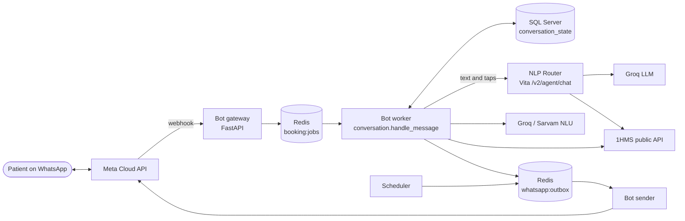
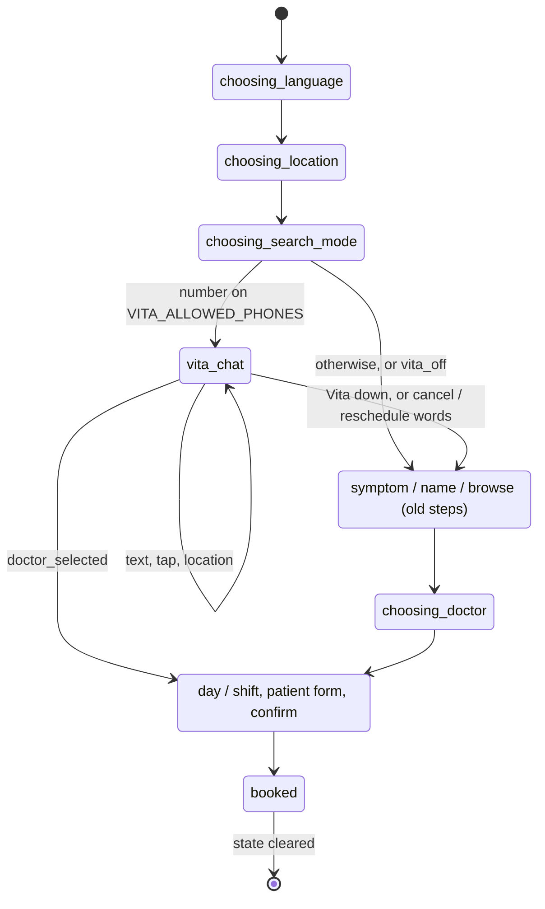
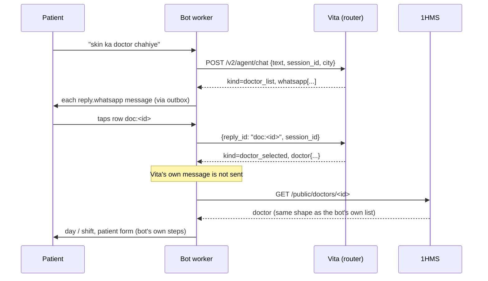

# WhatsApp bot + Vita: system architecture

Vita (chat agent in the NLP Router) finds the doctor; this bot books. The hand-over happens when the patient picks a doctor.

## 1. Context: who talks to whom

## 2. Bot containers (docker compose)

| Service | Job |
|---|---|
| fastapi | Receives Meta's webhook, verifies the signature, dedupes, queues the job. |
| worker | Runs the conversation. The only service that talks to Vita (`VITA_*` env). |
| sender | Drains the outbox at a Meta-safe rate. Order of messages is the order queued. |
| scheduler | Follow-up messages the day after a visit. |
| redis | Job queue, outbox, dedupe, locks. |

## 3. Conversation steps and where Vita sits

## 4. One Vita turn

## 5. Responsibilities

| | Vita | Bot |
|---|---|---|
| Understand symptoms, names, specialty, area | yes | old steps only |
| Emergency text (108/112) and location request | yes | own safety check outside the Vita step |
| Doctor list, show more, refine | yes | old list |
| Day, shift, patient details, confirm, book | no | yes |
| Cancel, reschedule, check-in, QR, follow-up | no | yes |

## 6. Failure behaviour

| Failure | What the patient sees |
|---|---|
| Vita unreachable, 401/403/429, 5xx, bad reply | One notice, then the three search buttons for the rest of the conversation. |
| 422 (expired session) on a typed message | New Vita session, no notice. |
| 422 on a tap on an old row | The introduction again. |
| Groq down inside Vita | Vita answers from its code steps (`engine: fallback`); the bot does not notice. |
| 1HMS cannot confirm the picked doctor | Error notice; stays with Vita; nothing is booked. |

## 7. Configuration and rollout

| Setting | Notes |
|---|---|
| `VITA_API_URL`, `VITA_API_KEY` | Router base URL and a `chat` scope client key. |
| `VITA_ALLOWED_PHONES` | Comma-separated numbers (last 10 digits matched), or `*`. Empty = off. |

Rollout: dev with own numbers, then a small allowlist on prod, then `*`. Prod workflow does not pass `VITA_*` yet, so prod stays off until added on purpose.
Limits: router `chat` scope 30 calls/min per key; Vita session 30 min; Meta list 10 rows, button 3.
